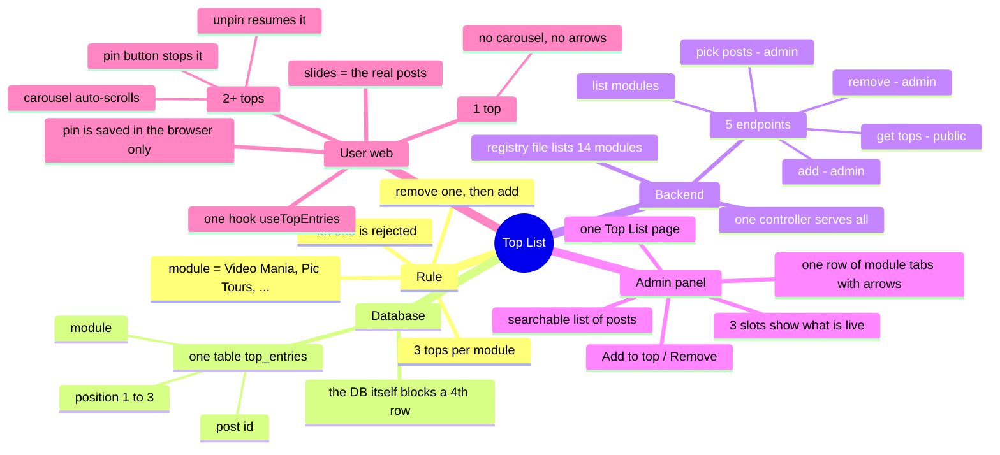

# Top List: how it works (simple version)

**One idea:** a "top" is not a copy of a post. It is a small note that says *"post #42 of Video Mania is currently a top"*. The post itself never moves, so anything you do to a post (like, comment, save, share, report, edit) works the same whether it is a top or not.



## The same thing as a picture

```
 ADMIN picks                         DATABASE                        USER sees
 -----------                         --------                        ---------
 Top List page  --Add to top-->  top_entries                    Video Mania page
 (Video Mania tab)               module     post  position      +-------------------+
                                 video_mania  42     1   --->   | carousel (3 tops) |
                                 video_mania  17     2          | auto-scroll       |
                                 video_mania  93     3          | [pin] stops it    |
                                      |                         +-------------------+
                                      |  points at the REAL post
                                      v
                                 xpi_videos (id 42, 17, 93)  <-- likes, comments, saves,
                                 (the normal posts)               shares all use these
```

## Who does what

| Piece | Job | Where |
|---|---|---|
| `top_entries` table | remembers which posts are top, in which slot | `backend/model/init.sql` |
| Module registry | says which table each module's posts live in (add a module = add one entry) | `backend/utils/topModules.js` |
| Controller | the 5 endpoints, enforces the limit of 3 | `backend/Controllers/topEntriesController.js` |
| Admin page | pick / remove tops | `admin/src/pages/TopList.jsx` |
| `useTopEntries` | the one call the website makes for a module | `user/src/hooks/useTopEntries.js` |
| Adapter | turns an API entry into the normal post shape the cards already understand | `user/src/utils/topEntries.js` |
| `TopRecord` + `useTopPin` | the carousel, auto-scroll and the browser-only pin | `user/src/components/ui/TopRecord.jsx`, `user/src/hooks/useTopPin.js` |

## What happens when...

* **An admin adds a 4th top** - the API answers "full, remove one first"; the button is also disabled in the page.
* **A post that is a top gets deleted** - it vanishes from the tops and its slot is reclaimed on the next add.
* **A module has no tops** - the page shows its normal "no top found" message.
* **A user pins a top** - the browser stores that post id; the carousel stops auto-scrolling until it is unpinned. Admin changes never touch pins.
* **An admin removes the top a user pinned** - the pin is forgotten automatically.

Full API reference: `TOP_LIST_API.md`.
